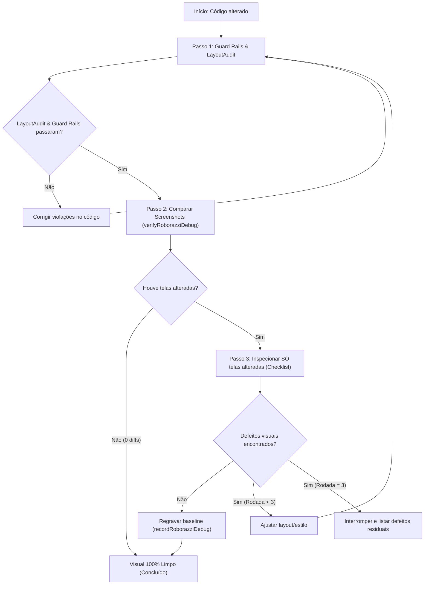

# Skill: Garantia de Qualidade Visual e Workflow Autônomo (visual-qa)

Esta skill define o protocolo mandatório de Garantia de Qualidade Visual (Visual QA) para qualquer alteração, refatoração ou adição de interface em Jetpack Compose no aplicativo móvel **Platform**.

> [!IMPORTANT]
> Toda tarefa que modifique ou adicione telas, componentes visuais ou estilos em Compose SÓ é considerada concluída quando o ciclo de QA visual for executado e terminar 100% limpo.

---

## 1. O Ciclo Visual de 3 Rodadas (Autonomous QA Loop)

O ciclo de inspeção visual opera em no máximo **3 rodadas iterativas**:

### Passo a Passo:
1. **Auditoria Automatizada (Zero Token)**:
   - Execute os guard rails do Gradle e o `LayoutAudit`:
     `./gradlew checkFileSize checkGradientsAndShadows checkHardcodedStrings checkLiteralColors checkRawShapes checkRawSurfaces testDebugUnitTest --tests "com.platform.app.test.audit.ScreenLayoutAuditTest"`
   - Se houver qualquer falha (overflow visual, quebra no meio da palavra, valores monetários truncados), corrija imediatamente antes de inspecionar imagens.
2. **Comparação de Screenshots**:
   - Execute a verificação de baseline do Roborazzi:
     `./gradlew verifyRoborazziDebug`
   - Se o Roborazzi acusar **0 diferenças**, pule completamente a etapa de visão (economia de tokens).
   - Se houver diferenças, liste precisamente quais telas foram alteradas.
3. **Inspeção Visual Cirúrgica**:
   - Abra **EXCLUSIVAMENTE** as imagens das telas que sofreram alteração (nos 3 temas: AMOLED, Dark e Light).
   - Avalie rigorosamente contra o Checklist de Inspeção Visual (Seção 2).
4. **Resolução de Defeitos & Limite de Rodadas**:
   - Aplique as correções necessárias e repita o ciclo.
   - Caso restem defeitos visuais não resolvidos na 3ª rodada, interrompa a execução e documente o relatório detalhado para alinhamento.

---

## 2. Checklist de Inspeção Visual

Ao inspecionar as imagens das telas modificadas, valide cada um dos seguintes critérios:

### 2.1 Alinhamento e Proporção
- **Hierarquia Tipográfica**: Textos de mesma hierarquia funcional possuem exatamente o mesmo peso e cor.
- **Valores Monetários**: Sempre formatados com números tabulares (`tnum`), centavos estilizados harmonicamente e alinhamento consistente. Nunca permita quebra de valor monetário (ex.: `R$` em uma linha e o número na outra).
- **Alinhamento de Linhas**: Ícones, textos e badges compartilham a mesma linha de centro ou linha de base conforme apropriado.

### 2.2 Contraste e Legibilidade
- **Tokens de Tema**: Chips, badges, botões e selos contrastam de forma nítida com o fundo em todos os temas.
- **AMOLED**: Superfícies e textos secundários permanecem perfeitamente legíveis sobre o preto absoluto (`#000000`).
- **Tema Claro**: Nenhum elemento fica invisível ou apagado por falta de contraste contra fundos claros.

### 2.3 Densidade e Respiração
- **Anti-Gigantismo**: Sem avatares ou caixas desproporcionalmente grandes.
- **Espaçamento Coerente**: Aplicação estrita da escala de espaçamento do sistema (`4.dp`, `8.dp`, `12.dp`, `16.dp`, `24.dp`).
- **Ausência de Zonas Mortas**: Sem vácuos verticais injustificados ou cartões comprimidos colados na borda.

### 2.4 Integridade do Texto e Acessibilidade
- **Sem Quebras de Palavra**: Nenhuma palavra quebrada no meio por compressão (ex.: `PARCE-` / `LADAS`).
- **Sem Elipses Prematuras**: Rótulos e títulos aproveitam a largura disponível antes de aplicar reticências.
- **Escala de Fonte**: Suporte e adaptação responsiva a escalas de acessibilidade (1.0x, 1.3x e 2.0x) sem estourar containers.

### 2.5 Fidelidade de Temas
- **AMOLED**: Fundo `#000000` real nos containers e backgrounds de tela principal.
- **Escuro (Dark)**: Tons de cinza profundo e tokens do Material 3 (`#121212` / `surfaceVariant`).
- **Design 100% Plano**: Zero sombras projetadas (`elevation = 0.dp`) e zero gradientes (`Brush.*`).

---

## 3. Diretrizes Rígidas de Economia de Tokens

Para garantir máxima eficiência no consumo de contexto e tokens:
1. **Nunca inspecione telas não modificadas**: Se a alteração foi em Contas, inspecione apenas os screenshots de Contas.
2. **Pule a visão quando não houver diff**: Se `verifyRoborazziDebug` passar com 0 alterações, a validação é concluída imediatamente sem abrir imagens.
3. **Escopo Mínimo**: Para uma única tela alterada, visualize estritamente os 3 arquivos de tema correspondentes (`screen_amoled_*.png`, `screen_dark_*.png`, `screen_light_*.png`).
4. **Relatório Visual Único**: Utilize o comando Gradle `./gradlew visualReport` para gerar `build/visual-report/index.html` e inspecionar comparativos antes/depois quando necessário.

---

## 4. Governança e Integração CI

- **Pré-Commit / Pré-Merge**: Todo PR deve executar `LayoutAudit` e os 6 guard rails com sucesso.
- **Artefatos CI**: O relatório visual gerado por `visualReport` é automaticamente anexado como artefato do build no GitHub Actions.
